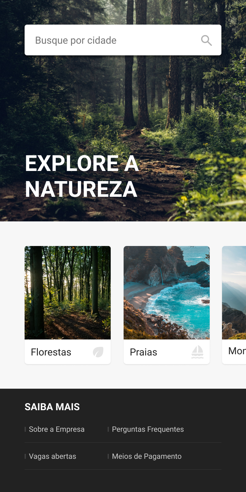

# 🌲 Projeto: Explore a Natureza

Este projeto prático foi desenvolvido durante o curso de **UI Design para Iniciantes** da 🐺Origamid (
Instrutor: André Rafael). O objetivo foi modelar uma interface mobile estática, focando na usabilidade e estruturação da
informação.

## 📱 Preview da Interface

  

## 🔗 Acesse o Projeto

- **Figma:
  ** [Inspecione as camadas e o design interativo clicando aqui](https://www.figma.com/design/CoZPZbOQumpeOAeltWBem7/UI-Design?node-id=3-3&t=BMn83uK4BPozpsSU-1)

## 🧠 Conceitos Aplicados (Visão Full Stack)

Como desenvolvedor em transição para Full Stack, encaro este protótipo no Figma como a **modelagem fundamental do
front-end**, assim como um diagrama UML modela a arquitetura do back-end. Neste exercício, apliquei:

* **Hierarquia Visual:** Definição clara do que o usuário deve ver primeiro através de pesos tipográficos.
* **Espaçamento e Alinhamento:** Uso consistente de margens para criar respiro e organizar a leitura.
* **Estruturação de Camadas:** Organização lógica dos grupos no Figma, pensando em como essas peças se transformariam em
  componentes reais de código (HTML/CSS ou frameworks).

---
*Desenvolvido como parte do portfólio de estudos contínuos em tecnologia e design.*

---

## 👤 Autor

Desenvolvido por Ivan Ferreira.

Copyright © 2026 Ivan Ferreira. Todos os direitos reservados.

## ☕ Sobre

Exercícios práticos e projetos desenvolvidos durante o treinamento de UI Design para Iniciantes da plataforma 🐺*
*Origamid**, ministrados pelo Prof. André Rafael.

