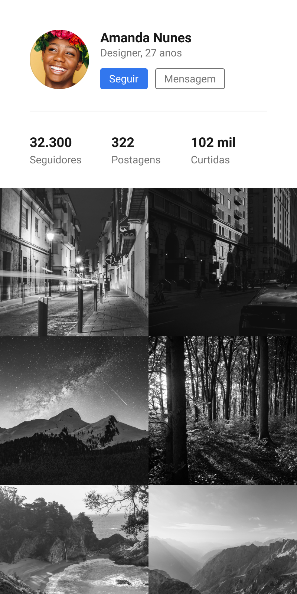

# 👤 Projeto: Perfil do Usuário

> **Curso:** UI Design para Iniciantes (_Origamid_)  
> **Instrutor:** André Rafael  
> **Objetivo:** Modelar uma interface mobile de perfil de usuário (estilo rede social), aplicando conceitos de
> hierarquia visual no cabeçalho, contraste em botões de ação (primário/secundário), organização de métricas e alinhamento
> em grid de galeria de fotos.

---

## 📱 Preview da Interface

  

---

## 💡 Conhecimentos Aplicados

- **Hierarquia de Cabeçalho:** Estruturação da foto de perfil em avatar circular em destaque ao lado do nome do usuário,
  ocupação e idade.
- **Ações Primárias e Secundárias:** Diferenciação visual entre botões de ação — botão principal preenchido em
  destaque (_Seguir_) e botão secundário em estilo _outlined_ (_Mensagem_).
- **Organização de Métricas:** Alinhamento e distribuição equilibrada dos contadores estatísticos (Seguidores, Postagens
  e Curtidas) com tipografia diferenciada entre valores e rótulos.
- **Grid de Mídias (Galeria):** Disposição uniforme de imagens em grade estilo _feed_ de publicação, garantindo simetria
  e alinhamento do conteúdo.
- **Tipografia e Contraste:** Seleção rigorosa de pesos de fonte (_bold_ para dados principais; _regular_ para
  informações complementares) para facilitar a leitura rápida.

---

## 📂 Estrutura do Diretório

```text
02-projeto-perfil-do-usuario/
├── assets/
│   └── perfil-do-usuario.png    # Cópia demonstrativa / Preview em imagem
├── docs/
│   └── perfil-do-usuario.fig    # Backup offline do arquivo nativo do Figma
└── README.md                    # Documentação técnica deste exercício
```
