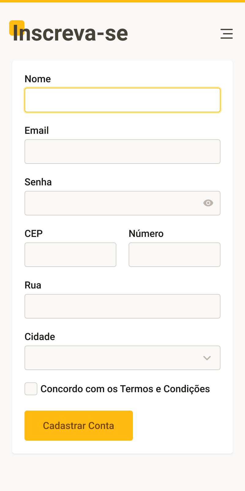

# 📝 Projeto: Formulário de Cadastro

> **Curso:** UI Design para Iniciantes ( 🐺 _Origamid_ )  
> **Instrutor:** André Rafael  
> **Objetivo:** Modelar uma interface mobile de formulário de cadastro, aplicando conceitos de arquitetura de informação, estados de input (foco, texto, senha com alternância de visibilidade), organização de campos em colunas, elementos de seleção (dropdown/checkbox) e hierarquia visual no botão de ação principal.

---

## 📱 Preview da Interface



---

## 🔗 Acesse o Projeto

- 🎨 **Protótipo Interativo no Figma:**
  [Inspecione as camadas e o design no Figma](https://www.figma.com/design/CoZPZbOQumpeOAeltWBem7/UI-Design?node-id=34-31&t=x8kYTNWoRFylp7OB-1)
- 💾 **Arquivo de Backup Local:** Disponível no formato `.fig` na pasta [`./docs/`](./docs/)

---

## 💡 Conhecimentos Aplicados

- **Arquitetura de Formulário:** Agrupamento lógico de campos de entrada em um cartão centralizado para melhorar o foco do usuário e a escaneabilidade visual.
- **Estados de Foco e Entrada:** Aplicação de contorno em destaque (borda amarela) para sinalizar o campo ativo (_Nome_), diferenciando-o dos campos em estado de repouso.
- **Affordance e Ícones Utilitários:** Utilização do ícone de olho no campo _Senha_ para alternância de visibilidade e ícone de _chevron_ no campo _Cidade_ para indicar um menu suspenso (_dropdown_).
- **Disposição de Layout em Colunas:** Alinhamento de campos complementares (_CEP_ e _Número_) lado a lado para otimizar o espaço vertical na tela do dispositivo móvel.
- **Controles de Seleção e CTA:** Inclusão de caixa de seleção (_checkbox_) para aceite dos termos e botão de ação primário (_Cadastrar Conta_) com alto contraste e cor de marca.

---

## 📂 Estrutura do Diretório

```text
03-projeto-formulario/
├── assets/
│   └── imagem-formulario.jpg    # Cópia demonstrativa / Preview em imagem
├── docs/
│   └── UI-Design.fig            # Backup offline do arquivo nativo do Figma
└── README.md                    # Documentação técnica deste exercício
```

<a href="../../">⬅️ <b>Voltar ao Repositório Principal</b></a>

---

## 👤 Autor

Desenvolvido por **Ivan Ferreira**.

Copyright © 2026 Ivan Ferreira. Todos os direitos reservados.

---

## 🎨 Sobre

Exercício prático desenvolvido durante os treinamentos de **UI Design** da plataforma 🐺 **Origamid**, ministrados pelo Prof. André Rafael.
