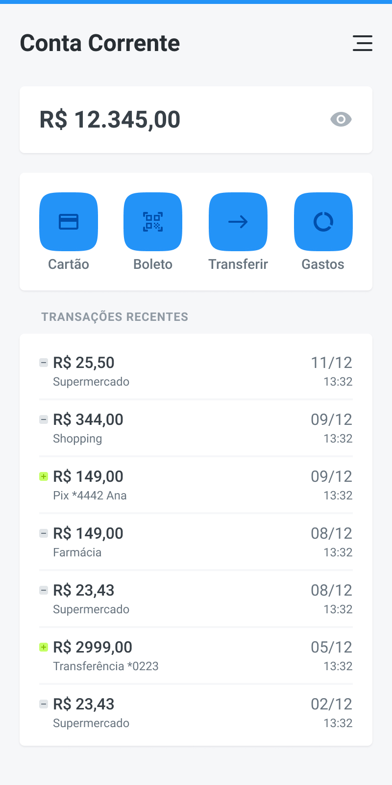

# 💳 Projeto: Dashboard de Finanças

> **Curso:** UI Design para Iniciantes ( 🐺 _Origamid_ )  
> **Instrutor:** André Rafael  
> **Objetivo:** Modelar uma interface mobile de dashboard bancário/financeiro (Conta Corrente), aplicando conceitos de
> visualização de saldo com controle de privacidade, atalhos de ações rápidas em grid, categorização visual de extrato
> com
> diferenciação entre entradas e saídas, e agrupamento de dados por cartões (*Card-based Layout*).

---

## 📱 Preview da Interface



---

## 🔗 Acesse o Projeto

- 🎨 **Protótipo Interativo no Figma:**
  [Inspecione as camadas e o design no Figma](https://www.figma.com/design/CoZPZbOQumpeOAeltWBem7/UI-Design?node-id=51-143&t=YzwVNCFmms5Ihkk7-1)
- 💾 **Arquivo de Backup Local:** Disponível no formato `.fig` na pasta [`./docs/`](./docs/)

---

## 💡 Conhecimentos Aplicados

- **Exibição de Saldo e Privacidade:** Estruturação de card em destaque para exibição do saldo principal, integrando o
  botão de alternância de visibilidade (_ícone de olho_) para proteção de dados sensíveis.
- **Grid de Ações Rápidas:** Organização de recursos frequentes (_Cartão, Boleto, Transferir, Gastos_) em cartões
  arredondados com ícones estilizados e rotulagem clara para garantir alta _affordance_.
- **Diferenciação Visual de Operações:** Listagem de transações recentes utilizando códigos de cor e símbolos gráficos
  para separar débitos/saídas (ícone neutro `-`) de créditos/entradas de recursos (ícone verde em destaque `+`).
- **Hierarquia do Extrato Financeiro:** Organização tipográfica para facilitar o escaneamento rápido, destacando o valor
  e o nome do estabelecimento/operação em primeiro plano, com data e hora alinhadas à direita.
- **Layout Baseado em Cards:** Aplicação de contêineres e cartões sobre fundo neutro para agrupar visualmente contextos
  distintos (Saldo, Atalhos e Histórico), aumentando a legibilidade e a usabilidade mobile.

---

## 📂 Estrutura do Diretório

```text
04-projeto-financas/
├── assets/
│   └── imagem-financas.jpg    # Cópia demonstrativa / Preview em imagem
├── docs/
│   └── UI-Design.fig          # Backup offline do arquivo nativo do Figma
└── README.md                  # Documentação técnica deste exercício
```

<a href="../../">⬅️ <b>Voltar ao Repositório Principal</b></a>

---

## 👤 Autor

Desenvolvido por **Ivan Ferreira**.

Copyright © 2026 Ivan Ferreira. Todos os direitos reservados.

---

## 🎨 Sobre

Exercício prático desenvolvido durante os treinamentos de **UI Design** da plataforma 🐺 **Origamid**, ministrados pelo
Prof. André Rafael.
